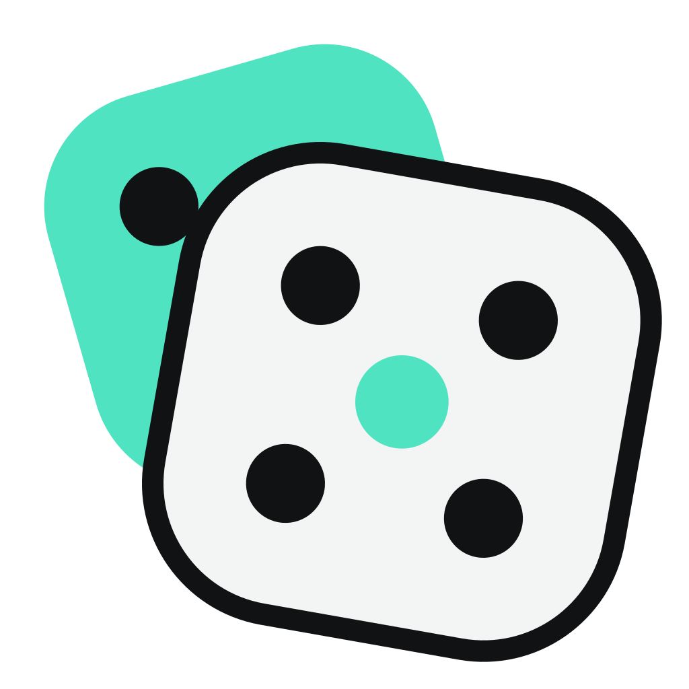

<p align="center">
  
</p>

<h1 align="center">Nearby Dice</h1>

<p align="center">
  <strong>The classic dice game for friends in the same room: one phone each, no internet needed.</strong>
</p>

<p align="center">
  <a href="https://github.com/lukasjakobi/nearby-dice/actions/workflows/check.yml"></a>
  <a href="https://github.com/lukasjakobi/nearby-dice/releases/latest"></a>
  <a href="LICENSE"></a>
  
  
  
</p>

Nearby Dice brings the classic Yatzy-style dice game to the table without a cup, a pen or a score
pad. Everyone plays on their own phone: one player opens a round, the others join with a short
code, and the phones connect directly to each other over **Google Nearby Connections**. Nobody needs
an internet connection or an account, so a game works just as well on a train or in a mountain hut
as at the kitchen table.

A round seats two to six players, and the app speaks German and English.

## ✨ Features

- 📡 **Play together offline:** phones connect directly, without internet, accounts or servers.
- 🎯 **Eight game modes:** classic rules, Scandinavian Yatzy, six-round Blitz games, identical rolls
  for everyone, a triple sheet with multipliers, the 17-field XL sheet and more. The host picks one
  and can switch it in the lobby or before a rematch.
- 🔄 **Never lose your seat:** a phone that drops out reconnects on its own and picks up where it
  left off. Even after the app restarts, you can return to the round from the start screen.
- 🧘 **Training mode:** practise on your own and chase your personal best.
- 📊 **Your history:** your last 10 games and lifetime statistics are stored on your phone.
- 🎉 **Yatzy celebration:** five equal dice wave a big "YATZY!" flag with a fanfare on every phone.
- 🔊 **Sound and haptics:** sound effects, optional background music and vibration, each with its own
  switch.
- 🌗 **Comfortable to use:** light and dark themes, large touch targets, and support for larger text
  and reduced motion.

## 📲 Get the app

Android users can download the latest APK from the
[releases page](https://github.com/lukasjakobi/nearby-dice/releases/latest). An iOS release isn't
available yet, but you can [build the app yourself](#-build-it-yourself).

## 🎲 How to play

1. One player taps **Hosten**, chooses a game mode and receives a four-character code.
2. The others tap **Beitreten** and enter that code.
3. Once at least one friend has joined, the host starts the game. From then on, every phone shows
   the same dice, turns and scores.

Want to play alone? **Training** starts a solo round.

## 🔐 Permissions

Nearby Dice needs permission to find and connect to nearby phones. Before the system dialog appears,
the app explains what it is asking for and why. Tap **Erlauben** to continue or **Später** to cancel.
If you declined, **Einstellungen öffnen** takes you straight to Settings, and the app carries on
when you come back.

| Platform | What the app asks for                                                                 |
| -------- | ------------------------------------------------------------------------------------- |
| Android  | Nearby devices (12+), nearby Wi-Fi devices (13+), local network (17+), location (all) |
| iOS      | Bluetooth, then Local Network                                                         |

Bluetooth must be switched on as well, and on Android so must Location Services. iPhones connect
over Wi-Fi, so whenever an iPhone is in the game, **every phone needs to be on the same Wi-Fi
network**.

## 🔧 Build it yourself

Nearby Dice relies on a native module that Expo Go can't load, so you run it as a **development
build**. You'll need Android Studio (with the SDK and a JDK) for Android, or Xcode for iOS. Connect
your phone and run:

```bash
npm install
```

```bash
npm run android
```

```bash
npm run ios
```

After the first build, `npm run dev` is all you need for JavaScript changes; rebuild only when
native code or `app.json` changes. Android debug builds install as a separate app, "Nearby Dice
Dev", so they can sit alongside the release version.

| Command                           | What it does                                                      |
| --------------------------------- | ----------------------------------------------------------------- |
| `npm run dev`                     | Start Metro for an installed development build                    |
| `npm run ios` / `npm run android` | Build, install and run the development build on a connected phone |
| `npm test`                        | Run all tests (`npm run test:watch` while working)                |
| `npm run typecheck`               | Type-check with `tsc --noEmit`                                    |
| `npm run lint`                    | Lint with ESLint (Expo config + Prettier)                         |
| `npm run format`                  | Format with Prettier                                              |
| `npm run check`                   | Typecheck, lint and test: run this before you push                |
| `npm run sounds`                  | Regenerate the original sound effects and music                   |

## 🧩 How it works

Every round has one host, and the host's phone acts as the referee.

- **The host decides.** It rolls the dice, checks every move and, after each change, sends the
  complete game to every guest. That way, all phones show the same board and history.
- **Guests make requests.** They send what they would like to do (roll, hold or score) and display
  the result the host sends back.
- **Screens follow the game.** As the round moves from lobby to countdown, game and results, every
  phone switches screens at the same moment.
- **Connections recover.** A guest that loses the connection retries three times and reclaims its
  seat with a secret rejoin token. After an app restart, the start screen offers to resume.

Want the details? The [scoring rules](docs/scoring.md) list every field with its points, and the
[technical design](docs/technical-design.md) covers the architecture, the
protocol and the permissions, and [PRODUCT.md](PRODUCT.md) explains what we are building and why.

## 🩺 Troubleshooting

| Problem                                      | Fix                                                                                                                            |
| -------------------------------------------- | ------------------------------------------------------------------------------------------------------------------------------ |
| "NearbyConnections native module is missing" | The app is running in Expo Go. Install the development build instead (`npm run ios` / `npm run android`)                       |
| No permission prompt on iOS                  | iOS asks only once per install. Reset it under Settings › General › Transfer or Reset › Reset Location & Privacy, or reinstall |
| An iPhone can't find the round               | Put all phones on the same Wi-Fi network and allow Local Network under Settings › Nearby Dice                                  |
| No sound on an iPhone                        | Check the mute switch, which silences the app. On Android, audio follows the media volume                                      |
| Changes to Kotlin or Swift have no effect    | Native code needs a rebuild: `npm run ios` / `npm run android`                                                                 |
| Stale bundle or odd module errors            | Restart Metro with a clean cache: `npx expo start --clear`                                                                     |
| Dependency version warnings                  | Run `npx expo install --fix`, then `npx expo-doctor`                                                                           |

## 🤝 Contributing

Contributions are very welcome! Right now, the most valuable help is **testing on real phones**: so
far, the Nearby connection has only been exercised over a simulated network. If you have two or more
phones at hand, start with the test plan in
[#25](https://github.com/lukasjakobi/nearby-dice/issues/25).

[CONTRIBUTING.md](CONTRIBUTING.md) explains how the project is organised, which conventions it
follows and how to open a pull request. Please report security issues privately, as described in
[SECURITY.md](SECURITY.md).

## 📄 License

Nearby Dice is released under the [MIT License](LICENSE). © 2026 Lukas Jakobi
