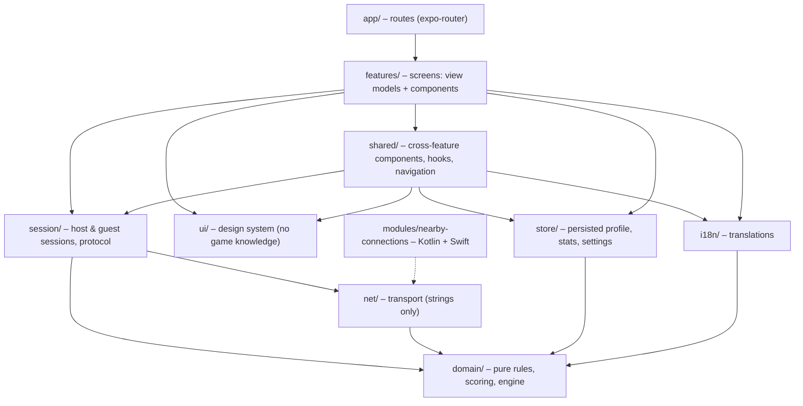
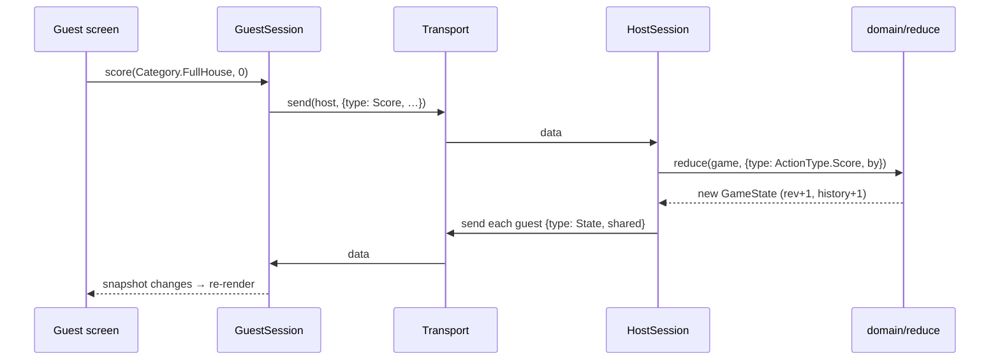

# Technical design

This document explains how Nearby Dice is built: its layers and folders, the core types, and how a
single move travels from one phone to all the others. For the bigger picture, head back to the
[product overview](../PRODUCT.md); for setup and commands, see the [README](../README.md).

**Status:** the game rules, sessions and screens are implemented and covered by the test suite. The
Nearby native bridge has not been confirmed on real devices yet.

## Principles

1. **English, typed code; translated text only at the edge.** Every state value is a TypeScript string
   `enum` (`FieldOrder.TopToBottom`, `SessionPhase.Lobby`, `CellState.Preview`). All text lives in
   `src/i18n/locales/{de,en}.json`, read through i18next with keys typed from `de.json`; enum labels
   are keyed by the enum value, and a test checks both files for the same keys and a label per enum
   value. The shell picks the language (`useAppLanguage`: the Settings choice, else the first device
   language with a catalog, else English). Logic and components never compare against display text.
2. **Dependencies point one way.** Lower layers never import higher ones, and `domain` imports
   nothing at all. ESLint enforces the table under [Layers](#layers) (`MAY_IMPORT` in
   `eslint.config.js`).
3. **The host is in charge.** It validates every move and broadcasts the complete shared state. Host
   and guest screens render the same `SessionSnapshot`; a player's role only decides which commands
   they can send.
4. **State drives navigation.** Screens never navigate on timers. A single layout maps the session
   phase to the right screen.
5. **Screens stay thin.** A view-model hook, often wrapping a pure `build…View` function, produces
   display-ready, enum-typed props. Components simply render those props and call callbacks.

## Layers

Each layer may only use the ones below it. The diagram shows who depends on whom; the table spells
out what each layer may and may not know about.



| Layer      | Knows about                                      | Must not know about                                      |
| ---------- | ------------------------------------------------ | -------------------------------------------------------- |
| `domain`   | nothing                                          | React, network, storage, app text                        |
| `lib`      | nothing                                          | the game and every other layer                           |
| `net`      | `domain` types (player colour in advertisements) | sessions, messages, UI                                   |
| `session`  | `domain`, `net`                                  | React components, routes, app text                       |
| `store`    | `domain` (types, checks, stats rules), `lib`     | network, UI                                              |
| `i18n`     | i18next, enums from `domain`, `session`, `store` | components, game logic                                   |
| `ui`       | theme tokens, `PlayerColor` from `domain`        | game, session, i18n                                      |
| `shared`   | everything above                                 | features                                                 |
| `features` | everything above                                 | other features' internals (only their `index.ts` barrel) |
| `app`      | `features`                                       | logic of any kind                                        |

## Folders

A closer look at what lives where. CONTRIBUTING.md explains the shape of a single feature folder
under "Feature folders".

```text
src/
  app/                        Routes only; each file re-exports a feature screen.
    _layout.tsx               → features/shell/AppShell (fonts, stores, theme, toasts, splash)
    index, onboarding, profile, settings, host-setup, join, training, saved-game
    (session)/_layout.tsx     → features/session/SessionLayout (phase → route, back, keep-awake)
    (session)/host-lobby, guest-lobby, game, results

  domain/                     enums, rules (presets), fields (every field and its points per ruleset),
                              sheet (layout), roll (dice analysis), joker, totals, scoring (score,
                              writeScore, allowedCategories), engine, autopick, random, player,
                              stats (saved games, lifetime totals), validation (shape checks for
                              received and stored games)
  net/                        transport.ts (interface), advertisement, roundCode, createTransport,
                              nearby/ (NearbyTransport, chunking), fake/ (in-memory network for tests)
  session/                    types, protocol, HostSession, GuestSession, handshake, RoundScanner,
                              timing, selectors, activeSession + useSession (React binding)
  store/                      createPersistedStore + storage (validated AsyncStorage), profile,
                              settings, stats, interrupted (zustand)
  i18n/                       i18next setup, locales/de.json + en.json, format (names, times)
  ui/                         theme/ (tokens, typography, ThemeProvider), Text, Button, IconButton,
                              Screen, Header, Card, TextField, Switch, Choice, Footer, Avatar,
                              Spinner, Banner, StatusView, Dialog, Sheet, Toast, DieFace, Logo, icons
  features/<screen|layout>/   index.ts barrel, Screen (or Layout), hooks/, view/, components/,
                              __tests__/
  shared/                     components/ (PlayerRow, PlayersSection, PresetGrid, PresetRow, PresetSheet, RulesSheet …),
                              hooks/ (useFeedback, useBackAction, useProfileForm …), navigation/
                              (navigate, Route enum), permissions/, view/ (rulesSummary, lobbyRows)
  lib/                        typed Emitter/Store, timers and delays, ids
  test/                       fixtures, render helpers, resetStores, BotPlayer + botMove (play full games)

modules/nearby-connections/   Local Expo module: Kotlin (play-services-nearby) + Swift
                              (google/nearby NearbyConnections), permissions included.
```

## Core types

These are the types everything else is built on, shortened to their essentials:

```ts
// domain
enum Ruleset { Classic, ClassicXl, Yatzy }
enum Category { Ones … Sixes, OnePair, TwoPairs, ThreeOfAKind, FourOfAKind,
                FullHouse, SmallStraight, LargeStraight, Yatzy, Chance, Even, Odd, Mini, LuckyNumber }
enum GameLength { Full, Short }            enum FieldOrder { Free, TopToBottom }
enum StartingPlayer { Random, Host }      enum Link { Connected, Lost, Removed, Left }
// Allowed values: ROLLS_PER_TURN, SECONDS_PER_TURN, SHEET_COUNTS (domain/rules.ts)
// Rules only ever come from PRESETS[PresetId]; matchPreset(rules) maps them back.
type Rules = { ruleset; rollsPerTurn: 2|3|4; secondsPerTurn: 0|30|60; sameDice; luckyNumber; upperBonus;
               length; sheets: 1|3; fieldOrder; startingPlayer };
type GameState = { rules; seed; players: GamePlayer[]; turnOrder; turn: Turn; finished;
                   history: HistoryEntry[]; rev };
function reduce(state, action: GameAction, ctx: { now; rng }): { state; rejected?: RejectReason };

// session
enum Role { Host, Guest, Training }
enum SessionPhase { Lobby, Countdown, Playing, Finished }
enum ConnectionStatus { Connected, Reconnecting, Failed }
enum EndReason { Kicked, LobbyClosed, GameEnded, Left }
type SharedSession = { sessionId; code; roundName; preset: PresetId; maxPlayers; allowRejoin; phase;
                       players: PlayerInfo[]; game: GameState | null; gameNumber;
                       rematch; countdownEndsAt; hostTime; rev };
type SessionSnapshot = { role; myId; shared: SharedSession; connection; ended; clockOffset };
```

The engine knows players only by their id. Names, colours and connection links live in
`SharedSession.players`.

**Every phone holds the complete game.** `GameState` contains every player's sheets and the full
`history` (scored, auto-scored, skipped and removed entries, each with its round and dice). The host
broadcasts it after every change, so any phone can show "Spielstand" and "Verlauf".

### Game modes

**Confirmed:** games are played only in the predefined presets ("Spielstil"); there are no
individual rule settings. The session shares its `preset`, and each game is created from
`PRESETS[preset]` (what each preset changes is in [scoring.md](scoring.md#presets)). The host picks a
preset when hosting and can switch it in the lobby and on the results screen (in Training, on its
results screen). Switching on the results screen resets every
guest's "yes" rematch vote to pending, so nobody ends up playing a mode they didn't agree to; the
host's own vote stays. Guests see the mode read-only and get the toast „Spielstil geändert: …“.

**Confirmed:** `ClassicXl` is the Classic XL ruleset with 17 fields per sheet. Its fields and points
are written in [scoring.md](scoring.md#classic-xl). `TwoPairs` is scored by one helper in `fields.ts`
that Yatzy shares.

**Confirmed:** the `luckyNumber` rule adds a `LuckyNumber` field to the lower block; its points are
in [scoring.md](scoring.md#lucky-number). While the field is open it shows the current target; once it
is filled or struck, the hint disappears. The Lucky Number preset turns this rule on for Classic, and
the XL preset selects `ClassicXl`.

### Further Yatzys

The further-Yatzy (joker) rule and its maximum points are written down in
[scoring.md](scoring.md#further-yatzys); `joker.ts` implements them.

## A move, end to end

Here is what happens when a guest enters a full house:



The host's own moves skip the network and call `reduce` directly. Only the host rolls dice (with a
seed per round for "Gleiche Würfel"), and every phone shakes its dice when `turn.rollSeq` goes up.
When the new faces land as five equal dice, every phone waves a "YATZY!" flag with the roller's name
and plays a fanfare (`useYatzyFlag`). It needs no extra message: each phone sees the same roll land.
Dice already on the table when the game screen opens, after a reconnect for example, show no flag.

With `luckyNumber`, `luckyNumberFor(seed, round)` derives the round's target from the game seed (the
rule is in [scoring.md](scoring.md#lucky-number)). `luckyNumberOf(state)` uses `currentRound(state)`,
so every player on their nth turn shares the same target, whether or not "Gleiche Würfel" is on. No
extra message is needed.

## Protocol (`session/protocol.ts`)

Messages are JSON with `v: 6` and are validated on arrival: unknown types, other versions and
messages with missing fields are dropped.

**Confirmed compatibility:** version 2 replaced free-form `rules` with the session's `preset`, and
version 3 renamed the ruleset and category values, version 4 removed the rule options no preset
used, version 5 changed Classic XL's `TwoPairs` points, and version 6 gave every mode the same
[further-Yatzy rule](#further-yatzys) and removed the `joker` and `yatzyBonus` options, so phones on
different versions simply ignore each other. Every game must use a preset's rules exactly. Until a game is finished, that is the
session's preset; afterwards the host may already have picked the next one. Sheets and history must
match the game's rules.

| Message                                  | Direction       | Purpose                                                       |
| ---------------------------------------- | --------------- | ------------------------------------------------------------- |
| `Hello`                                  | guest → host    | device id, profile, Nearby auth token, rejoin token           |
| `Welcome` / `Reject`                     | host → guest    | seat + full state, or `full` / `removed` / `started`          |
| `State`                                  | host → all      | the complete `SharedSession` after every change               |
| `Roll`, `Hold`, `Score`, `Vote`, `Leave` | guest → host    | intents                                                       |
| `Focus`, `ViewSheet`                     | guest → host    | the selected field and the open sheet, so others follow along |
| `Kick`, `Close`                          | host → guest(s) | removed; lobby closed or game ended                           |
| `Ping` / `Pong`                          | both            | liveness every 2 s; a peer counts as lost after 6 s           |

- **Confirmed:** tapping a player's pill opens their sheet on that phone only, without a message.
  It stays open whatever the player whose turn it is does (rolling, selecting a field, switching
  sheets) and closes with "Zurück" or when the turn ends. Following along stays shared; looking
  around is private, so it never moves anyone else's screen.
- There are no separate lobby or start messages: the phase and `countdownEndsAt` are part of the
  shared state, so applying the same update twice changes nothing.
- `join(code)` lives in the session layer (`handshake.ts`) rather than in `Transport`, which only
  moves strings. The guest sees three steps: search → secure connection → join.

**Confirmed connection lifecycle:**

- A single deadline covers a whole join or reconnect attempt, from the search to the host's answer
  (see Timings under [Open questions](#open-questions)). If it passes, the attempt fails as "not
  found". Cancelling ends the attempt immediately, even during `Transport.connect`, which takes an
  abort signal. Once a connection exists, any failure (HELLO not sent, no answer, rejected,
  cancelled) closes it again.
- A resolved `send` means the radio accepted the data, not that it arrived. A rejected `send` counts
  as a lost link: the host closes it and marks the player as lost, while the guest closes it and
  reconnects. Failed intents are not retried, because the reconnect's `Welcome` carries the host's
  current state anyway. Data lost in flight without an error is caught by the liveness check.
- The native module cancels a pending connection request when JavaScript disconnects from its
  endpoint, and `stopAllEndpoints` rejects pending requests on both platforms. **Open:** confirm on
  devices that Nearby really cancels the radio handshake.

Nearby limits byte payloads to 32 KB, so `NearbyTransport` splits large states into chunks of at
most 8,000 characters.

### Admission (`session/HostSession.ts`)

**Confirmed:** the host admits each connection at most once, following these rules:

- **Identity.** The device ID is a stable, self-reported label, not a credential. Only the session's
  rejoin token, together with the same device ID, gives a seat back, and it then replaces that
  seat's old link. Anything else counts as a new join, which only the lobby accepts while seats are
  free. A device whose lobby link broke without its token (after an app restart, say) joins afresh,
  and its orphaned seat makes room.
- **Secrets.** Rejoin tokens and device IDs come from `secureRandomId` (`expo-crypto`). Player,
  session and chunk IDs are not secret and use the injectable `randomId`.
- **Bans** after a kick or removal match the device ID, so they are best effort: a modified client
  can claim a different one.
- **One HELLO per connection.** A second HELLO, or one with the wrong Nearby auth token, closes the
  link. A connection that hasn't sent HELLO within `helloTimeout` is closed, and at most
  `MAX_PENDING_ADMISSIONS` connections may wait for theirs at once; the host refuses any more.
- **Message cap.** A peer that sends more than `MAX_MESSAGES_PER_WINDOW` messages per `rateWindow`
  loses its link, just like a dropped connection (an admitted guest then reconnects with its token).
- **Rejected intents** resync only their sender with a `State`; nobody else gets a broadcast. A
  repeated rematch vote changes nothing and isn't broadcast either.

The advertised player count updates with every lobby change: join, leave and kick.

## Navigation

`features/session/routing.ts` decides which screens a phone may show, through
`allowedRoutes(snapshot)`:

| Phase     | Host and Training                   | Guest                                        |
| --------- | ----------------------------------- | -------------------------------------------- |
| Lobby     | host-lobby (Training never has one) | guest-lobby                                  |
| Countdown | game (countdown overlay)            | guest-lobby (first game) / results (rematch) |
| Playing   | game                                | game                                         |
| Finished  | game for a moment, then results     | same                                         |

Whenever the current route isn't allowed, the session layout replaces it. When a session ends, the
host and any guests who left go back to Start. Guests who were removed, or whose round was closed,
see the end view first.

**Training** (`session/TrainingSession.ts`) is a single-player session started from the Training
screen. It runs `reduce` locally, just like the host, but without a transport, lobby or rematch
votes; "Nochmal spielen" calls `restart()`. Training results keep their own best score
(`trainingBest` in the stats store) and never affect wins, the Yatzy count or saved games.

**Confirmed:** host setup, join and "Fortsetzen" on Start each own the session they open until they
hand it to `setActiveSession` (after join's short success pause, or on "Zurück ins Spiel"). Going
back, cancelling or leaving the screen abandons the attempt: a session that arrives later is closed
(advertising stopped, link disconnected) and never becomes active or navigates.

## Stored data

**Confirmed:** the profile, settings, statistics and interrupted session are zustand stores in
`store/`. Each is made by `createPersistedStore` and saved to AsyncStorage under one fixed key
(`nearbydice.<store>.v1`). A store holds only its defaults, a `sanitize` function and its actions.
Game rules, such as how a finished game changes the statistics, live in `domain/stats.ts`.

Loading and saving go through `createValidatedStorage` (`store/storage.ts`). It never overwrites
stored data before a copy of it exists:

- `sanitize` keeps the fields that pass their checks, and zustand fills the rest from the defaults.
  If that changes anything, even one saved game inside `recent`, the stored text is first copied to
  `<key>.corrupt.<timestamp>` and the cleaned state is written back, so the copy is made once.
- Text that can't be parsed is copied the same way and the key is removed, so the store starts
  from its defaults.
- If reading fails, the store starts from its defaults and blocks its writes until a read
  succeeds. Otherwise the next change would replace the profile, device id or statistics that are
  still on disk. Changes made in that session aren't saved.
- If a copy can't be written, writes stay blocked as well.
- An action that leaves the data unchanged, such as recording a game that is already saved, writes
  nothing.
- A new stored shape raises the store's `version` and adds a `migrate` step, which runs before
  `sanitize`. The key never changes, or the data already on phones would be lost. Every store is
  at version 0 so far.

## Saved games

**Confirmed:** every phone saves each finished multiplayer game in full, as a `SavedGame` in the
stats store (`nearbydice.stats.v1`). A saved game holds the final `GameState` (rules, every
player's sheets and the full history), every player's id, name and colour, the phone's own `myId`,
and `playedAt`. Each phone saves its own copy from the state it already has, so the protocol doesn't
change.

- Only the 10 most recent games are kept: saving an 11th drops the oldest. There is no age limit.
- Lifetime stats per mode (wins, best score, Yatzy count) are updated when a game is saved
  (`recordGame` in `domain/stats.ts`) and include every game ever played, even those no longer
  kept. "Statistik zurücksetzen" clears both.
- Training games are never saved, and neither is a game on a phone that left or was removed before
  the end.
- When loading, the app drops any saved game that fails `isGameState`, isn't finished, was played
  with rules no preset uses, or whose players don't match its sheets. It also drops rows from older
  versions that only kept place, points and opponents, and stats without a mode. The stored text
  is copied first (see [Stored data](#stored-data)).

"Zuletzt gespielt" on Start lists the kept games. Tapping one opens `saved-game?id=…`, which reuses
the results view (ranking, awards, "Alle Felder im Vergleich") and adds "Verlauf".

## Permissions

The native module handles permissions with each platform's own mechanism and reports them to
JavaScript as Expo's `PermissionResponse` (`status`, `canAskAgain`).

- **Android:** Expo's permission manager requests exactly what Nearby needs on the running SDK level:
  - Bluetooth scan, advertise and connect (12+).
  - Nearby Wi-Fi devices (13+).
  - Coarse location on every version, plus fine location in the same request from API 29.
  - Local network (17+).

  The manifest entries live in the module. Both location permissions are declared for every
  version, even though
  [Google's Nearby setup guide](https://developers.google.com/nearby/connections/android/get-started)
  stops at API 31: Play services reported missing coarse location (`8034`) on an API 36 phone.
  `getRadioState()` checks Bluetooth first and then Android Location Services on every SDK level,
  because the module doesn't declare `neverForLocation`.

- **iOS:** the app asks for Bluetooth first, then for Local Network access. iOS offers no API to
  request the latter, so a short Bonjour probe (`NWListener` + `NWBrowser` on our service type)
  triggers the prompt, and only after an explicit permission request. The module remembers that a
  request happened but never caches the answer; later checks probe again, so changes made in
  Settings take effect
  ([Apple TN3179](https://developer.apple.com/documentation/technotes/tn3179-understanding-local-network-privacy)).
  `NSBonjourServices` must list `_<SHA-256(service id)[0..12] hex>._tcp`, and a test guards it.

  The location usage description stays declared because
  [Nearby's iOS setup](https://developers.google.com/nearby/connections/swift/get-started) requires
  location access for Wi-Fi Hotspot bandwidth upgrades. The bridge doesn't request it yet, so those
  upgrades are currently unavailable. The usage descriptions and `NSBonjourServices` live in
  `app.json` → `ios.infoPlist`.

In the app, a permission gate shows an explanation sheet before any system prompt. "Erlauben"
requests access and "Später" cancels. A denied request shows "Berechtigung fehlt" with "Einstellungen
öffnen". If Bluetooth or Location Services are off, a sheet opens the matching settings, and when the
app returns to the foreground it checks again and carries on once everything is ready.

## Testing

The tests run real host and guest sessions over an in-memory network, so they cover the game and
its synchronisation, but not the radio itself.

| Layer      | What is covered                                                                                                                                                                                                                                    |
| ---------- | -------------------------------------------------------------------------------------------------------------------------------------------------------------------------------------------------------------------------------------------------- |
| `domain`   | Unit tests for every field in all rulesets, jokers, bonuses, lucky-number targets, three sheets, the timeout pick, full games per preset, saved games: limit of 10, duplicates; `scoringExamples` checks every example in [scoring.md](scoring.md) |
| `net`      | Round codes, advertisements, chunking, the in-memory network, the Bonjour/service-id guard                                                                                                                                                         |
| `session`  | Real `HostSession` + `GuestSession`s over `FakeNetwork` with fake timers: join, rejects, kick, close, a full game with identical state on every phone, rematch, reconnect, give up                                                                 |
| `features` | Pure view builders (`buildGameView`), routing, and screens rendered with RNTL against a fake controller                                                                                                                                            |
| `store`    | Validated hydration: one copy per cleaned state, writes blocked after a failed read or copy, migration, dropped rows; no write for unchanged data                                                                                                  |

## Open questions

| Topic         | Position                                                                                                                                                          |
| ------------- | ----------------------------------------------------------------------------------------------------------------------------------------------------------------- |
| Nearby on iOS | **Open.** On iOS, Nearby works over Wi-Fi LAN (Bluetooth support is newer), so mixed rounds need every phone on the same Wi-Fi. Confirm on devices.               |
| Swift package | **Open.** `spm_dependency` on `github.com/google/nearby`, product `NearbyConnections`; confirm the version on the first iOS build.                                |
| Timings       | **Proposed:** 12 s per join, reconnects at 0, 2 and 5 s, 8 s per reconnect attempt, and a peer counts as lost after 6 s. All of them live in `session/timing.ts`. |
